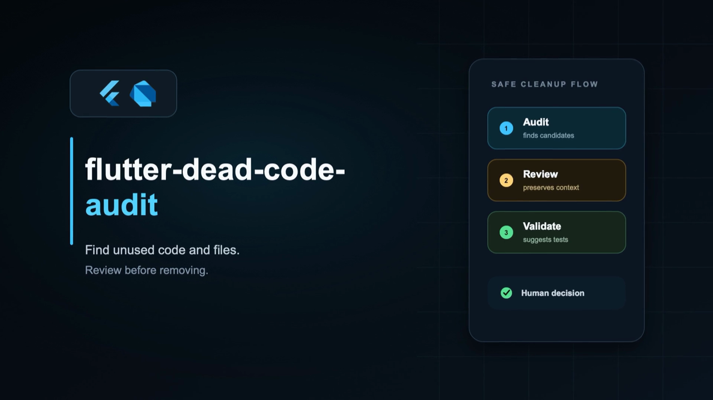
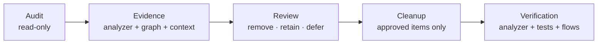

<div align="center">

[Português](README.md) · **English**

# flutter-dead-code-audit

**Find unused Dart code and files. Review the evidence. Remove only what was approved.**

[](https://flutter.dev)


An Agent Skill for auditing dead code in Flutter and Dart projects with static evidence, mandatory human review, and verifiable cleanup.

</div>

## Demo

<div align="center">

[](assets/demo-en.mp4)

**[▶ Watch the full video](assets/demo-en.mp4)**

</div>

## Why this skill exists

Finding a missing reference is easy. Proving that code can be safely removed is not.

Flutter and Dart projects may hide consumers behind barrels, routes, dependency injection, code generation, flavors, conditional imports, platform channels, tests, and public APIs. A text search or a one-off diagnosis usually sees only part of that system.

This skill turns the investigation into a repeatable process:



> The skill finds **candidates**. It does not automatically declare code dead.

## Why use it instead of asking an AI for a one-off diagnosis

An AI can reason well about code. The weakness of a one-off prompt is the absence of a consistent protocol across runs.

| One-off diagnosis | `flutter-dead-code-audit` |
|---|---|
| Depends on how the prompt was written | Uses the same auditable workflow every time |
| May stop at text search | Combines analyzer diagnostics, a dependency graph, and repository context |
| May treat “no reference found” as “safe to delete” | Requires false-positive checks before recommending removal |
| Decisions disappear into chat history | Records `remove`, `retain`, and `defer`, including reasons and review dates |
| May produce one large deletion | Works in small, reviewable, verifiable batches |
| Often ends with “run the tests” | Maps removals to affected tests and user flows |
| May hide uncertainty | Separates evidence, confidence, risk, and missing context |

The differentiator is not merely “using AI.” It is giving the AI a specialized, conservative, and reproducible process.

## What the skill does

### 1. Audit — read-only by default

- Runs `dart analyze --format=machine` when Dart is available.
- Collects diagnostics for unused imports, declarations, fields, variables, and unreachable branches.
- Builds a deterministic `import`, `export`, and `part` graph.
- Finds files with no inbound directive, files unreachable from known roots, and files reachable only from tests.
- Keeps stale commented code separate from executable dead code.
- Produces candidates with evidence, confidence, removal risk, and a verification recommendation.

### 2. Review — mandatory human decision

Every candidate or homogeneous group receives an explicit decision:

- `remove` — approved for a later Cleanup operation.
- `retain` — intentionally kept, always with a concrete reason.
- `defer` — waiting for missing technical or product context.

Decisions can be persisted as JSON. Retained code remains visible in later audits and can receive a future review date.

### 3. Cleanup — controlled removal

- Removes only previously approved candidate IDs.
- Rechecks references before editing.
- Keeps batches small for easier review and rollback.
- Preserves callbacks, listeners, lifecycle behavior, and surrounding side effects.
- Does not mix cleanup with refactoring or feature work.
- Runs formatting, analyzer checks, tests, and builds proportional to the risk.

### 4. Verification — behavior after removal

In addition to automated checks, the skill maps changes to developer-facing manual verification flows, including:

- navigation and visible state;
- authentication and permissions;
- media playback and camera behavior;
- persistence and synchronization;
- lifecycle and platform integrations;
- flavors and feature flags.

It clearly separates checks performed by the agent from checks still requiring a person or device.

## Key differentiators

- **Conservative by design:** one missing reference is never enough evidence.
- **Flutter-aware:** understands entrypoints, flavors, routes, DI, codegen, platform channels, and public APIs.
- **Deterministic where it matters:** scripts use analyzer output and a reproducible graph, not only text interpretation.
- **Write-only state is not automatic cleanup:** it may indicate an incomplete feature or regression.
- **Decision-oriented reports:** executive summary, reviewable groups, risks, and progressively disclosed evidence.
- **Decision memory:** intentionally retained code stays documented instead of being rediscovered during every audit.
- **Privacy-aware:** script output uses relative paths and does not expose the absolute project path.
- **No external Python dependencies:** scripts use the Python standard library only.

## Report categories

- 🟢 **Ready for review** — strong evidence and ready for a human decision.
- 🟡 **Review carefully** — likely unused, but located at a sensitive boundary.
- 🟠 **Needs team context** — intent cannot be established from the repository.
- 🔴 **Potential logic issue** — may be a bug rather than cleanup.
- 🔵 **Intentionally retained** — kept with a documented reason.
- ⚪ **Not dead / excluded** — investigated and removed from the decision queue.

## Installation

### Recommended installation

From the root of the project where you want to use the skill, run:

```bash
npx skills add LucasMenezeslc/flutter-dead-code-audit
```

When prompted, choose the agent and installation scope. Then confirm that the `flutter-dead-code-audit` folder was created in the skills directory and restart or sync the agent so it reloads the available skills.

### Manual installation

Clone the repository:

```bash
git clone https://github.com/LucasMenezeslc/flutter-dead-code-audit.git
```

Copy the complete folder — including `SKILL.md`, `scripts/`, and `references/` — into the project's skills directory. Common project-local destinations include:

```text
.claude/skills/flutter-dead-code-audit/
.codex/skills/flutter-dead-code-audit/
```

To verify the installation, ask the agent to list its available skills or invoke `$flutter-dead-code-audit` directly. If it does not appear, restart the editor or agent session.

## Usage

### Start with a read-only audit

```text
Use $flutter-dead-code-audit in Audit mode on this project.
Do not modify files. Create a report and present the first review group.
```

### Review candidates

```text
Use $flutter-dead-code-audit in Review mode.
Show candidates in small groups and wait for my remove, retain, or defer decision.
```

### Apply approved removals

```text
Use $flutter-dead-code-audit in Cleanup mode.
Remove only candidates already marked remove and generate the affected verification flows.
```

## Requirements

- Python 3.10 or newer.
- A Flutter or Dart project with a `pubspec.yaml` file.
- Dart on `PATH`, or an SDK available through FVM, for analyzer diagnostics.

If Dart is unavailable, the file inventory and dependency graph can still run.

## What it does not cover

This skill is not an audit for:

- duplicate code;
- unused assets;
- localization resources;
- unused dependencies in `pubspec.yaml`;
- application performance or security.

It also does not delete generated files directly, change analyzer rules, or install tools into the project during an audit.

## Structure

```text
flutter-dead-code-audit/
├── README.md
├── README.en.md
├── LICENSE
├── SKILL.md
├── agents/
│   └── openai.yaml
├── assets/
│   ├── demo-cover.png
│   ├── demo-cover-en.png
│   ├── demo.mp4
│   └── demo-en.mp4
├── references/
│   ├── audit-method.md
│   ├── cleanup.md
│   ├── false-positives.md
│   ├── report-design.md
│   ├── review.md
│   └── verification.md
└── scripts/
    ├── audit_flutter_dead_code.py
    ├── inventory_dart_graph.py
    └── test_*.py
```

## Development

Run the test suite without creating bytecode inside the repository:

```bash
PYTHONDONTWRITEBYTECODE=1 python3 -m unittest discover -s scripts -p 'test_*.py' -v
```

The tests cover analyzer diagnostics, the Dart file graph, conditional imports, public packages, generated files, and persisted review decisions.

## Suggestions and contributions

Suggestions that make the audit safer, clearer, and more useful are welcome. Open an issue with a real-world case, propose a workflow improvement, or submit a pull request with tests.

When reporting a false positive or false negative, include a minimal reproducible example and explain which Flutter or Dart behavior must be preserved. Do not include private code, credentials, or personal paths.

## Philosophy

> Dead code is a technical hypothesis until evidence and context agree.

Removal is safe only when the team understands why the code appears dead, why it may exist, and how to prove that supported behavior still works after the change.

## License

Distributed under the [MIT License](LICENSE). Copyright © 2026 Lucas Menezes.
