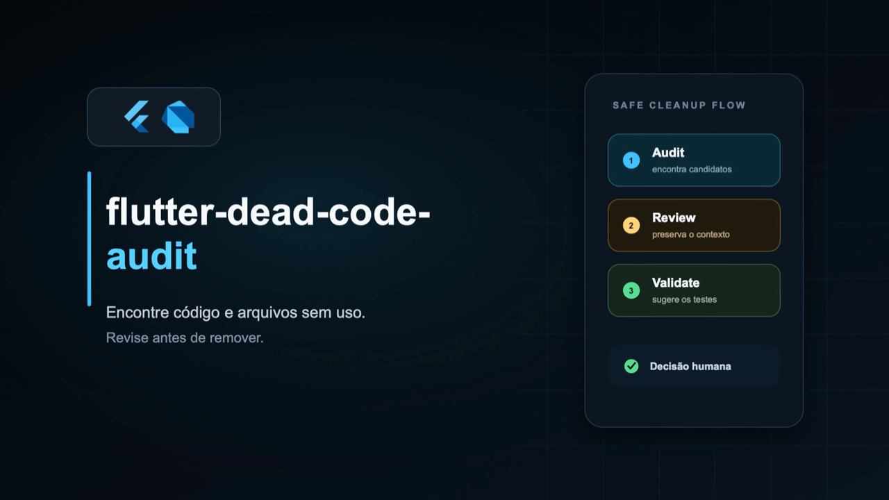
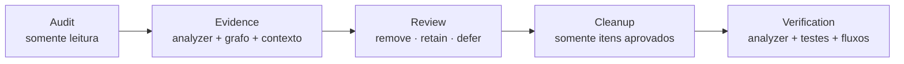

<div align="center">

**Português** · [English](README.en.md)

# flutter-dead-code-audit

**Encontre código e arquivos Dart sem uso. Revise as evidências. Remova somente o que foi aprovado.**

[](https://flutter.dev)


Uma Agent Skill para auditar dead code em projetos Flutter e Dart com evidência estática, revisão humana obrigatória e cleanup verificável.

</div>

## Demonstração

<div align="center">

[](assets/demo.mp4)

**[▶ Assistir ao vídeo completo](assets/demo.mp4)**

</div>

## Por que esta skill existe

Encontrar uma referência ausente é fácil. Provar que um código pode ser removido com segurança é outra história.

Projetos Flutter e Dart podem esconder consumidores em barrels, rotas, injeção de dependência, codegen, flavors, imports condicionais, platform channels, testes e APIs públicas. Uma busca textual ou um diagnóstico isolado costuma enxergar apenas parte desse cenário.

Esta skill transforma a análise em um processo repetível:



> A skill encontra **candidatos**, não decreta automaticamente que algo está morto.

## Por que usar em vez de pedir um diagnóstico solto para uma IA

Uma IA pode raciocinar bem sobre código. O problema de um prompt isolado é a falta de um protocolo consistente entre execuções.

| Diagnóstico ad hoc | `flutter-dead-code-audit` |
|---|---|
| Depende de como o prompt foi escrito | Usa o mesmo workflow auditável em toda execução |
| Pode se limitar a busca textual | Combina analyzer, grafo de dependências e inspeção contextual |
| Pode confundir “sem referência” com “seguro para apagar” | Exige verificações de falso positivo antes da recomendação |
| Decisões desaparecem no histórico do chat | Registra `remove`, `retain` e `defer`, com motivo e revisão futura |
| Pode remover tudo em uma alteração grande | Trabalha em lotes pequenos, revisáveis e verificáveis |
| Normalmente termina em “rode os testes” | Relaciona cada remoção aos testes e fluxos de produto afetados |
| Pode ocultar incerteza | Separa confiança, risco, evidência e contexto pendente |

O diferencial não é “usar IA”. É dar à IA um processo especializado, conservador e reproduzível.

## O que a skill faz

### 1. Audit — somente leitura por padrão

- Executa `dart analyze --format=machine` quando o Dart está disponível.
- Identifica diagnósticos relacionados a imports, declarações, campos, variáveis e branches sem uso.
- Monta um grafo determinístico de `import`, `export` e `part`.
- Encontra arquivos sem entrada, inalcançáveis ou acessíveis apenas por testes.
- Separa código comentado obsoleto de dead code executável.
- Produz candidatos com evidência, confiança, risco e verificação recomendada.

### 2. Review — decisão humana obrigatória

Cada candidato ou grupo recebe uma decisão explícita:

- `remove` — aprovado para uma futura etapa de cleanup.
- `retain` — mantido intencionalmente, sempre com um motivo.
- `defer` — depende de contexto técnico ou de produto ainda indisponível.

As decisões podem ser persistidas em JSON. Código retido continua visível em auditorias futuras e pode receber uma data de revisão.

### 3. Cleanup — remoção controlada

- Remove apenas IDs previamente aprovados.
- Revalida referências antes de editar.
- Mantém lotes pequenos para facilitar revisão e rollback.
- Preserva callbacks, listeners, lifecycle e outros efeitos colaterais.
- Não mistura cleanup com refatoração ou feature work.
- Executa formatação, analyzer, testes e builds proporcionais ao risco.

### 4. Verification — comportamento depois da remoção

Além das verificações automatizadas, a skill mapeia alterações para fluxos que o desenvolvedor precisa validar manualmente, como:

- navegação e estado visual;
- autenticação e permissões;
- reprodução de mídia e câmera;
- persistência e sincronização;
- lifecycle e integrações de plataforma;
- flavors e feature flags.

Ela diferencia claramente o que foi executado pelo agente do que ainda precisa ser testado por uma pessoa.

## Principais diferenciais

- **Conservadora por design:** ausência de referência nunca é evidência suficiente sozinha.
- **Flutter-aware:** entende entrypoints, flavors, rotas, DI, codegen, platform channels e APIs públicas.
- **Determinística onde importa:** os scripts usam o analyzer e um grafo reproduzível, não apenas interpretação textual.
- **Write-only não vira cleanup automático:** estado escrito e nunca lido pode indicar uma feature incompleta ou regressão.
- **Relatórios para decidir:** resumo executivo, grupos revisáveis, riscos e evidências progressivamente detalhadas.
- **Memória de decisões:** código intencional permanece documentado em vez de ser redescoberto a cada auditoria.
- **Privacidade:** a saída dos scripts usa caminhos relativos e não inclui o caminho absoluto do projeto.
- **Sem dependências Python externas:** os scripts usam apenas a biblioteca padrão.

## Categorias do relatório

- 🟢 **Ready for review** — evidência forte, pronto para decisão humana.
- 🟡 **Review carefully** — provável dead code em uma área sensível.
- 🟠 **Needs team context** — a intenção não pode ser provada pelo repositório.
- 🔴 **Potential logic issue** — pode ser bug, não apenas cleanup.
- 🔵 **Intentionally retained** — mantido com motivo documentado.
- ⚪ **Not dead / excluded** — investigado e removido da fila de decisão.

## Instalação

### Instalação recomendada

Na raiz do projeto em que você quer usar a skill, execute:

```bash
npx skills add LucasMenezeslc/flutter-dead-code-audit
```

Quando solicitado, escolha o agente e o escopo de instalação. Depois, confirme que a pasta `flutter-dead-code-audit` foi criada no diretório de skills e reinicie ou sincronize o agente para que ele releia as skills disponíveis.

### Instalação manual

Clone o repositório:

```bash
git clone https://github.com/LucasMenezeslc/flutter-dead-code-audit.git
```

Copie a pasta completa — incluindo `SKILL.md`, `scripts/` e `references/` — para o diretório de skills do projeto. Exemplos de destinos comuns:

```text
.claude/skills/flutter-dead-code-audit/
.codex/skills/flutter-dead-code-audit/
```

Para confirmar a instalação, peça ao agente para listar as skills disponíveis ou invoque `$flutter-dead-code-audit` diretamente. Se ela não aparecer, reinicie o editor ou a sessão do agente.

## Como usar

### Comece por uma auditoria

```text
Use $flutter-dead-code-audit em modo Audit neste projeto.
Não modifique arquivos. Gere um relatório e apresente o primeiro grupo para revisão.
```

### Revise os candidatos

```text
Use $flutter-dead-code-audit em modo Review.
Mostre os candidatos em grupos pequenos e aguarde minha decisão entre remove, retain e defer.
```

### Aplique somente o que foi aprovado

```text
Use $flutter-dead-code-audit em modo Cleanup.
Remova apenas os candidatos já marcados como remove e gere os fluxos de verificação afetados.
```

## Requisitos

- Python 3.10 ou superior.
- Um projeto Flutter ou Dart com `pubspec.yaml`.
- Dart no `PATH` ou um SDK disponível via FVM para os diagnósticos do analyzer.

Se o Dart não estiver disponível, o inventário de arquivos e o grafo de dependências ainda podem ser executados.

## O que ela não cobre

Esta skill não é uma auditoria de:

- código duplicado;
- assets sem uso;
- traduções/localizações;
- dependências sem uso no `pubspec.yaml`;
- performance ou segurança da aplicação.

Também não remove arquivos gerados diretamente, não altera regras do analyzer e não instala ferramentas no projeto durante a auditoria.

## Estrutura

```text
flutter-dead-code-audit/
├── README.md
├── README.en.md
├── LICENSE
├── SKILL.md
├── agents/
│   └── openai.yaml
├── assets/
│   ├── demo-cover.png
│   ├── demo-cover-en.png
│   ├── demo.mp4
│   └── demo-en.mp4
├── references/
│   ├── audit-method.md
│   ├── cleanup.md
│   ├── false-positives.md
│   ├── report-design.md
│   ├── review.md
│   └── verification.md
└── scripts/
    ├── audit_flutter_dead_code.py
    ├── inventory_dart_graph.py
    └── test_*.py
```

## Desenvolvimento

Execute a suíte de testes sem criar bytecode no repositório:

```bash
PYTHONDONTWRITEBYTECODE=1 python3 -m unittest discover -s scripts -p 'test_*.py' -v
```

Os testes cobrem diagnósticos do analyzer, grafo de arquivos, imports condicionais, packages públicos, arquivos gerados e decisões persistentes.

## Sugestões e contribuições

Sugestões para tornar a auditoria mais segura, clara e útil são bem-vindas. Você pode abrir uma issue com um caso real, propor uma melhoria no fluxo ou enviar um pull request acompanhado de testes.

Ao reportar um falso positivo ou falso negativo, inclua um exemplo mínimo reproduzível e explique qual comportamento Flutter ou Dart precisa ser preservado. Não inclua código privado, credenciais ou caminhos pessoais.

## Filosofia

> Dead code é uma hipótese técnica até que evidência e contexto concordem.

A remoção só é segura quando o time entende por que o código parece morto, por que ele pode existir e como provar que o comportamento suportado continua funcionando depois da mudança.

## Licença

Distribuído sob a [licença MIT](LICENSE). Copyright © 2026 Lucas Menezes.
